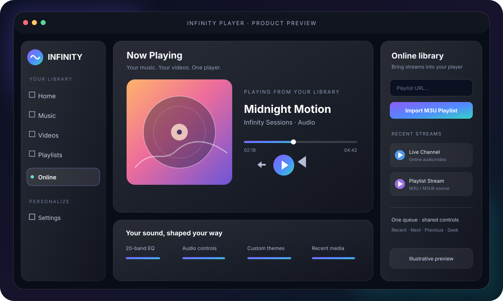

  

<h1 align="center">INFINITY PLAYER</h1>

<strong>Your media. Your controls. One cinematic space.</strong>

  <a href="https://avinashnewdev.github.io/Infinity-Player/"><strong>▶ LAUNCH WEB APP</strong></a>
  &nbsp;·&nbsp;
  <a href="https://github.com/avinashnewdev/Infinity-Player/releases"><strong>GET THE LATEST RELEASE</strong></a>
  &nbsp;·&nbsp;
  <a href="https://github.com/avinashnewdev/Infinity-Player/issues"><strong>REPORT AN ISSUE</strong></a>

  
  
  
  

---

**Infinity Player** is a browser-based audio and video player designed to bring your local media library and supported online streams into one customizable experience. It combines a cinematic interface, playback tools, playlists, profiles and a shared Now Playing workflow.

  

Illustrative product preview created with SVG — this is a design illustration, not a captured application screenshot.

## ✨ Why Infinity Player?

- **One place for your media** — browse audio and video in a unified player experience.
- **Control the listening experience** — use Now Playing, playback navigation, seeking, volume and supported audio/video options.
- **Make it yours** — customize the look with themes, accent colors, backgrounds and glass-style effects.
- **Bring playlists along** — import supported M3U channel lists and play online streams through the main player queue.
- **Pick up where you left off** — use Recent media and saved playback position where available.

## 🚀 Feature highlights

| Experience | What you can do |
|---|---|
| Local media | Add audio/video files and folders through the browser's file picker |
| Now Playing | Shared playback surface for supported local and online media |
| Online playlists | Import M3U playlists from a file or a CORS-accessible URL |
| Queue controls | Play a selected channel, continue through the imported list, use Next/Previous |
| Recent media | Keep a lightweight history of recently played items |
| Audio tools | Equalizer presets/custom EQ, playback speed and supported audio options |
| Video tools | Fit/fill/stretch, zoom, subtitles and supported audio-track selection |
| Personalization | Profiles, favorites, themes, accent colors and background options |
| Installable web app | PWA installation where the browser and hosting environment support it |

### Online playback, connected to the player

Online M3U entries are routed into the core player queue rather than being played in a separate mini-player. This allows supported streams to use the existing Now Playing screen, queue navigation and Recent history.

**Compatibility matters:** a stream still depends on its format, browser codec support, server CORS/range behavior, network availability and any provider restrictions. HLS/M3U8 playback is not guaranteed in every browser. YouTube playlists use the official embedded player and remain subject to YouTube's own playback and control rules.

## ▶ Get started

### Option 1 — Open the live web app

1. Visit the **[Infinity Player web app](https://avinashnewdev.github.io/Infinity-Player/)**.
2. Add local media with the library's file/folder controls.
3. To use an online playlist, open **IPTV**, import an M3U file or a hosted playlist URL, then choose a channel. Direct `.m3u8` stream URLs can be added without fetching the manifest first.
4. Use **Now Playing** for the main playback controls.

### Option 2 — Install it as a web app (PWA)

When supported by your browser:
- **Chrome / Edge on desktop:** open the app and use the browser's Install app option (or the Online tab's install instructions).
- **Android:** open the app in a supported browser and choose Install app / Add to Home screen.
- **iPhone / iPad:** in Safari, use Share → Add to Home Screen.

PWA installation is not the same as a native Windows EXE, Android APK or iOS App Store application.

### Option 3 — Run from source

1. Clone or download this repository.
2. Serve the project from a local HTTP server (recommended for PWA/service-worker features).
3. Open the local site in a current browser.

For a quick local server with Python installed:

\`\`\`bash
python -m http.server 8000
\`\`\`

Then open \`http://localhost:8000\`.

## 🧭 Project status & compatibility

Infinity Player is currently delivered as a **web app / installable PWA**. The browser supplies the media engine, so actual playback compatibility varies by browser and device.

- No promise of universal codec support: unsupported codecs may fail even when a file can be imported.
- Some online playlist URLs cannot be fetched by a browser because the remote host blocks CORS.
- Some network streams require authentication, special headers or DRM and may not work in this client.
- Online playback, track switching and audio processing should be tested with the specific stream and browser.
- YouTube embedded playback follows YouTube's own restrictions.

## 🛣️ Roadmap

These are future targets, not included downloadable binaries:
- Native Windows desktop package (EXE)
- Android APK and iOS application builds
- A native playback backend for broader codec coverage
- Automated cross-browser and device playback tests
- More localization and accessibility improvements

## 🧰 Technology

- HTML, CSS and JavaScript
- HTML5 media and browser playback APIs
- Web Audio APIs for supported audio processing
- Browser storage for preferences, profiles and lightweight history
- GitHub Pages deployment and PWA manifest/service worker

## 🗂️ Repository layout

\`\`\`text
.
├── .github/workflows/       # Pages deployment and release automation
├── assets/
│   ├── infinity-player-logo.svg
│   └── marketing/           # Product preview artwork
├── css/
├── js/vlc/                  # Online playlist and codec helpers
├── index.html               # Main application
├── manifest.webmanifest     # PWA metadata
├── service-worker.js        # Offline shell caching
├── LICENSE
└── README.md
\`\`\`

## 🗞️ Releases

- **Latest version:** see [GitHub Releases](https://github.com/avinashnewdev/Infinity-Player/releases).
- **Publish a release:** open the [Publish Infinity Player Release workflow](https://github.com/avinashnewdev/Infinity-Player/actions/workflows/publish-release.yml), choose **Run workflow**, enter a version such as `1.1.0`, and start the run.
- Releases include a web/PWA source package and release notes.
- Native EXE/APK/iOS installers will only be listed after separate native builds are implemented and tested.

## 🛡️ License & permissions

**© 2026 Avinash Jadhav. All rights reserved.**

This repository is public for viewing and demonstration. It is not an open-source project and does not grant permission to copy, modify, rebrand, redistribute, sublicense or commercially exploit the software without prior written permission, except for rights GitHub's Terms of Service expressly grant. Read [LICENSE](LICENSE) before using the source.

A public repository cannot technically prevent copying. This notice states the permissions being granted; it is not code obfuscation or copy protection.

## 🙌 Author

**Avinash Jadhav** · [@avinashnewdev](https://github.com/avinashnewdev)

  <strong>INFINITY PLAYER</strong> 
  One player. Your whole media world.

## Download helper

Windows PowerShell download script: [scripts/download-app.ps1](scripts/download-app.ps1). It downloads the latest published web/PWA ZIP when available, otherwise the latest source ZIP from `main`. It does not create a native EXE.
